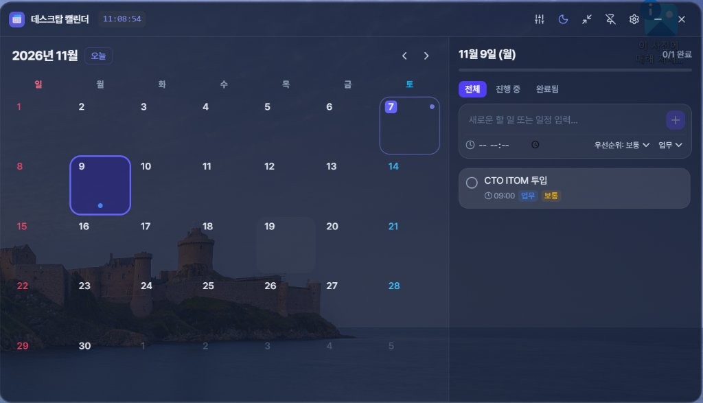

# 📅 데스크탑 캘린더 & 투두 위젯 (Desktop Calendar Widget)

[](https://jaekeunbaik.github.io/Calendar/)
[](https://github.com/jaekeunbaik/Calendar/releases)
[](https://jaekeunbaik.github.io/Calendar/)

Electron과 React 19, TypeScript, Tailwind CSS를 기반으로 제작된 세련된 글래스모피즘(Glassmorphism) 바탕화면 캘린더 및 일정 관리 위젯입니다.

🌐 **공식 다운로드 사이트**: [https://jaekeunbaik.github.io/Calendar/](https://jaekeunbaik.github.io/Calendar/)

---

## 📸 스크린샷



---

## ✨ 주요 기능

### 1. 🗓️ 스마트 월간 달력
- **한국 공휴일 및 대체공휴일 자동 표시**: 2024년 ~ 2028년 및 양력 고정 공휴일 (설날, 추석, 대체공휴일 등) 자동 계산 및 표기
- **일요일(빨강) / 토요일(파랑)** 직관적 색상 구분
- **오늘 날짜 강조** 및 선택 날짜 표시
- **일정 내용 미리보기 칩**: 각 날짜 칸에 일정 제목과 시간이 깔끔한 칩 형태로 노출
- **한 주의 시작 요일 설정**: 일요일 시작 / 월요일 시작 지원

### 2. 📝 할 일 & 일정 관리 (Todo List)
- **우선순위 관리**: 높음(빨강), 보통(주황), 낮음(초록)
- **카테고리 분류**: 업무, 개인, 공부, 중요, 기타
- **시간 설정**: 특정 시간(HH:mm) 지정 지원
- **진행도 프로그레스 바**: 선택된 날짜의 달성률 실시간 시각화
- **필터링 기능**: 전체 / 진행 중 / 완료됨 탭 및 카테고리별 필터

### 3. 🪟 데스크탑 위젯 최적화
- **투명 프레임리스 윈도우**: 윈도우 프레임 없이 깔끔하게 바탕화면에 안착
- **드래그 이동 지원**: 상단 바를 드래그하여 원하는 위치로 자유롭게 이동 (위치 자동 기억)
- **항상 위에 고정 (Always on Top)**: 핀 아이콘으로 원클릭 고정/해제
- **투명도(Opacity) 실시간 조절**: 30% ~ 100% 슬라이더로 조절
- **3가지 테마**: 다크(Dark Glass), 라이트(Light Glass), 글래스(Frosted Glass)

### 4. 📱 미니 위젯 모드 (Mini Mode)
- 한 번의 클릭으로 화면 구석에 둘 수 있는 **콤팩트 미니 위젯**으로 전환 (340x460)
- 초 단위 **실시간 디지털 시계** 및 오늘 날짜/공휴일 표시
- 오늘의 할 일 확인 및 즉시 완료 체크 / 빠른 등록 지원

### 5. ⚙️ 시스템 트레이 & 데이터 편의성
- **시스템 트레이 연동**: 작업 표시줄 트레이 아이콘에서 위젯 숨기기/보이기, 항상 위에 고정, 미니 모드 전환, 자동 실행 설정 지원
- **윈도우 시작 시 자동 실행 (Auto-launch)** 지원
- **데이터 백업 및 복원**: JSON 파일로 내보내기/가져오기 기능 내장

---

## 🚀 개발 및 빌드 방법

### 1. 패키지 설치
```bash
npm install
```

### 2. 개발 모드 실행 (Vite + Electron 동시 구동)
```bash
npm run dev
```

### 3. 프로덕션 빌드 및 실행
```bash
# Vite 빌드
npm run build

# 위젯 실행
npm start
```

### 4. 윈도우 설치 파일 패키징 (.exe / .zip)
```bash
npm run dist
```
생성된 설치 파일은 `release/` 폴더에서 확인하실 수 있습니다.

---

## 📄 라이선스

This project is licensed under the ISC License.
Copyright © 2026 jaekeunbaik.
